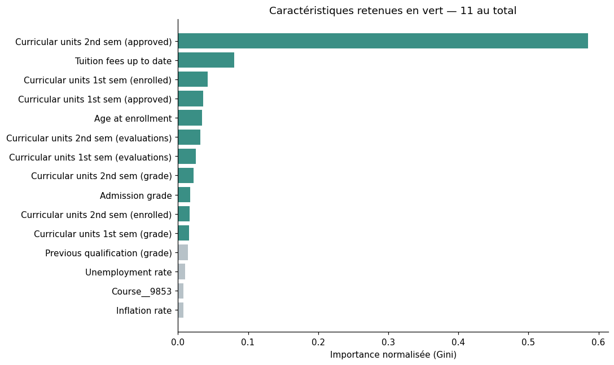

# Student Dropout Prediction

Mini-projet M113, Master IDIA, FST Tanger. La tâche 1 prépare les données, implémente un arbre CART avec NumPy/Pandas et sélectionne les variables communes aux trois membres.

## Contenu de la contribution de Charaf

| Élément | Utilisation |
| --- | --- |
| `01_preparation_arbre.ipynb` | Notebook commenté en français, avec résultats et figures intégrés. |
| `data/raw/data.csv` | Fichier UCI original, séparateur point-virgule. |
| `shared/` | Matrices sélectionnées, cibles, splits, mapping et paramètres communs. |
| `results/task1/` | Comparaison des arbres, importances, statistiques, structure de l'arbre et figures. |
| `rapport_partie1.md` | Contribution à intégrer au rapport commun. |

Les tâches 2 et 3 seront ajoutées par les deux autres membres. Le rapport et le notebook définitifs du groupe réuniront les trois contributions.

## Exécution dans VS Code

Utiliser Python 3.11 ou ultérieur. L'environnement vérifié emploie Python 3.12, avec les versions des bibliothèques consignées dans `shared/metadata.json`.

1. Ouvrir le dossier racine `student-dropout-prediction` dans VS Code.
2. Installer les extensions Python et Jupyter si nécessaire.
3. Installer les dépendances dans l'environnement Python choisi.

```bash
python -m pip install -r requirements.txt
```

4. Ouvrir `01_preparation_arbre.ipynb` et choisir cet environnement via **Select Kernel**.
5. Exécuter **Restart Kernel**, puis **Run All**.

Le fichier brut inclus permet de travailler hors ligne. Si ce fichier manque, la première partie tente de le télécharger depuis UCI. Le notebook régénère `shared/`, `results/task1/` et le texte du rapport. La version du contrat reste stable lorsque les données et la sélection sont identiques.

## Protocole appliqué

- Classes communes dans l'ordre `Dropout`, `Enrolled`, `Graduate`.
- Découpage stratifié déterministe, graine 42, avec 2 653 lignes de train, 883 de validation et 888 de test.
- Schéma one-hot appris sur train. Variables binaires et quantitatives conservées numériquement.
- Arbre CART, Gini, implémentation NumPy, métriques calculées avec NumPy.
- Comparaison d'un arbre de base et de neuf configurations de pré-élagage.
- Choix du meilleur F1 macro de validation, départagé par le nombre de nœuds.
- Sélection à 90 % d'importance cumulée. Les 11 colonnes retenues sont exportées avant standardisation.
- Test réservé aux évaluations finales des étapes suivantes.

## Résultats de la tâche 1

| Modèle | F1 macro train | F1 macro validation | Nœuds |
| --- | --- | --- | --- |
| Arbre sans limite de profondeur, feuille minimale 1 | 1.0000 | 0.5932 | 985 |
| Arbre retenu, profondeur maximale 8, feuille minimale 5 | 0.7664 | 0.6738 | 199 |

Le premier partage porte sur les unités validées au deuxième semestre. Le tableau complet et les temps mesurés se trouvent dans `results/task1/tree_comparison.csv`.



Les résultats incluent des informations du deuxième semestre. Ils décrivent une classification rétrospective. La disponibilité exacte des variables au moment d'un abandon individuel reste une limite. Les importances Gini sont propres à l'arbre et sensibles aux corrélations. La sélection supervisée préalable doit aussi être signalée dans l'interprétation de K-means.

## Transmettre aux collègues

Partager le dossier `shared/` complet, avec une seule version commune. Dans leurs notebooks, charger les données en conservant `row_id` comme index.

```python
from pathlib import Path
import json
import pandas as pd

shared = Path("shared")
features = json.loads(
    (shared / "selected_features.json").read_text(encoding="utf-8")
)["features"]
labels = pd.read_csv(shared / "labels.csv", index_col="row_id")
X_train = pd.read_csv(shared / "X_train.csv", index_col="row_id").loc[:, features]
y_train = labels.loc[X_train.index, "Target"]
```

Appliquer le même chargement à `val` et `test`. Ajuster la standardisation sur train. Les collègues doivent réutiliser les splits et les colonnes fournis. `row_id`, `split` et `Target` restent exclus des entrées des modèles.

## Vérification

Les cellules ont été exécutées dans l'ordre dans un processus Python neuf et leurs sorties ont été enregistrées. Le transport réseau d'un noyau Jupyter étant indisponible dans l'environnement de préparation, l'exécution a utilisé IPython dans le même processus. L'exécution interactive dans VS Code reste à vérifier sur l'ordinateur de l'étudiant.

Les contrôles du notebook couvrent les cas purs/constantes, une séparation connue, le multiclasse, la taille minimale des feuilles, le F1, les identifiants, les splits et les exports CSV. Une vérification supplémentaire a comparé les coupures à une recherche exhaustive sur des petits jeux synthétiques. Deux exécutions complètes ont produit les mêmes données communes.

## Sources et attribution des données

Le fichier brut et ses dérivés sont distribués sous la licence CC BY 4.0 des données UCI. Les transformations réalisées sont décrites dans le notebook et `shared/preprocessing.json`.

- Realinho, V., Vieira Martins, M., Machado, J., & Baptista, L. (2021). *Predict Students' Dropout and Academic Success*. UCI Machine Learning Repository. [Données et dictionnaire](https://doi.org/10.24432/C5MC89).
- Realinho, V., Machado, J., Baptista, L., & Martins, M. V. (2022). *Predicting Student Dropout and Academic Success*. Data, 7(11), 146. [Article](https://doi.org/10.3390/data7110146).
- [Licence CC BY 4.0](https://creativecommons.org/licenses/by/4.0/).

L'article décrit 35 attributs. Le fichier UCI utilisé contient 36 prédicteurs et une cible. Son empreinte SHA-256 est conservée dans `shared/metadata.json`.
