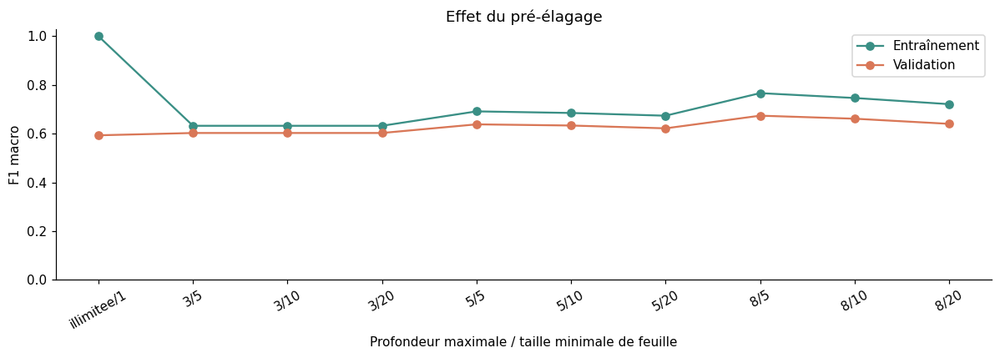
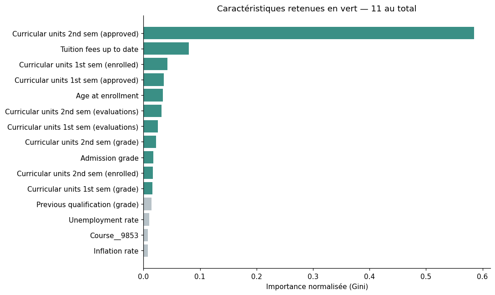

# M113 — Contribution de la tâche 1

## Description des données

Le fichier UCI lu contient 4424 lignes, 36 variables explicatives et la cible `Target`. Les effectifs mesurés sont 1421 Dropout, 794 Enrolled et 2209 Graduate. Le contrôle trouve 0 valeur manquante et 0 ligne dupliquée. Le champ d'assiduité comportait une tabulation finale supprimée des noms de colonnes. Les observations sont conservées. [1]

## Synthèse d'un travail de recherche

Realinho et ses collègues décrivent en 2022 la construction d'une base issue de données administratives et académiques de l'Institut polytechnique de Portalegre. Leur article analyse notamment le déséquilibre des classes, la multicolinéarité et l'importance des variables. Il motive ici l'usage du F1 macro et une interprétation prudente des importances. La publication décrit 35 attributs, tandis que la version UCI effectivement téléchargée fournit 36 prédicteurs. Nous documentons la version utilisée par son empreinte. Cette contribution doit être complétée par les lectures des deux autres membres. [1, 2]

## Prétraitements et protocole

Le découpage stratifié déterministe donne 2653 lignes de train, 883 de validation et 888 de test. Neuf variables catégorielles sont encodées selon les catégories présentes dans train. Les autres colonnes conservent leurs valeurs numériques. Cela produit 225 colonnes avant sélection. Les catégories nouvelles de validation/test sont encodées à zéro pour leur variable et comptabilisées dans `preprocessing.json`. Aucun remplacement de valeurs manquantes n'est nécessaire.

La validation sert au choix de complexité de l'arbre. Aucun score de test n'est calculé dans la tâche 1. Les collègues appliqueront leur standardisation ajustée sur train. Ce découpage 60/20/20 est un choix du groupe. L'arbre choisi et les importances sont appris sur train.

## Implémentation et amélioration

L'arbre CART est implémenté avec NumPy. Il utilise Gini, des seuils entre valeurs distinctes, une construction récursive et des feuilles prédisant la classe majoritaire. Les sommes cumulées accélèrent le calcul des coupures. Le pré-élagage est étudié en comparant un arbre sans limite de profondeur à neuf combinaisons de profondeur et de taille minimale des feuilles. Les métriques sont calculées avec NumPy. Des exemples synthétiques vérifient les coupures, les cas constants/purs, le multiclasse et le F1.

## Résultats

| max_depth | min_samples_leaf | nodes | train_f1_macro | val_f1_macro | retained |
| --- | --- | --- | --- | --- | --- |
| illimitee | 1 | 985 | 1.0000 | 0.5932 | False |
| 3 | 5 | 15 | 0.6323 | 0.6027 | False |
| 3 | 10 | 15 | 0.6323 | 0.6027 | False |
| 3 | 20 | 15 | 0.6323 | 0.6027 | False |
| 5 | 5 | 59 | 0.6915 | 0.6382 | False |
| 5 | 10 | 59 | 0.6849 | 0.6334 | False |
| 5 | 20 | 53 | 0.6737 | 0.6218 | False |
| 8 | 5 | 199 | 0.7664 | 0.6738 | True |
| 8 | 10 | 155 | 0.7464 | 0.6614 | False |
| 8 | 20 | 121 | 0.7211 | 0.6403 | False |

L'arbre retenu a une profondeur maximale paramétrée de 8, une taille minimale de feuille de 5 et 199 nœuds. Son F1 macro vaut 0.7664 sur train et 0.6738 sur validation. Le modèle de base obtient 0.5932 sur validation. L'écart de validation du modèle retenu par rapport à la base est +0.0806.

La première coupure porte sur `Curricular units 2nd sem (approved)` au seuil 3.5. Le seuil de 90 % d'importance cumulée retient 11 colonnes, représentant 90.66% de l'importance.

| feature | importance |
| --- | --- |
| Curricular units 2nd sem (approved) | 0.5848 |
| Tuition fees up to date | 0.0802 |
| Curricular units 1st sem (enrolled) | 0.0427 |
| Curricular units 1st sem (approved) | 0.0360 |
| Age at enrollment | 0.0343 |
| Curricular units 2nd sem (evaluations) | 0.0318 |
| Curricular units 1st sem (evaluations) | 0.0252 |
| Curricular units 2nd sem (grade) | 0.0223 |
| Admission grade | 0.0173 |
| Curricular units 2nd sem (enrolled) | 0.0163 |
| Curricular units 1st sem (grade) | 0.0156 |

## Discussion et limites

Le gain de Gini décrit les décisions de cet arbre. Il peut favoriser des variables offrant beaucoup de coupures et répartir l'importance entre prédicteurs corrélés. La sélection à 90 % est une convention à évaluer dans les modèles suivants. Le choix de paramètres sur une seule validation reste sensible au découpage. Les classes et le contexte institutionnel limitent la généralisation à une autre population.

Les résultats du deuxième semestre sont utilisés. L'analyse est rétrospective et ne démontre pas une capacité d'alerte dès l'inscription. Les dates individuelles d'abandon ne sont pas fournies. La sélection utilisant les vraies classes, K-means travaillera ensuite dans un espace sélectionné de façon supervisée. Les groupes devront être interprétés avec cette limite.

## Conclusion de la partie

Le dossier `shared/` version 1 fournit aux collègues les 11 entrées retenues, les identifiants et les mêmes splits. Les étapes de classification et de clustering pourront mesurer leur pertinence pour les objectifs du projet.

## Bibliographie

1. Realinho, V., Vieira Martins, M., Machado, J., & Baptista, L. (2021). Predict Students' Dropout and Academic Success. UCI Machine Learning Repository. https://doi.org/10.24432/C5MC89. Données sous licence CC BY 4.0.
2. Realinho, V., Machado, J., Baptista, L., & Martins, M. V. (2022). Predicting Student Dropout and Academic Success. Data, 7(11), 146. https://doi.org/10.3390/data7110146.

Empreinte SHA-256 du CSV brut — `3ef126de5cefff26eb11fbb4237f1a1401cb64b488e2f1d598c23cedeb4c45ae`.
