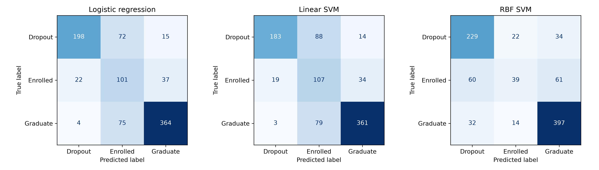
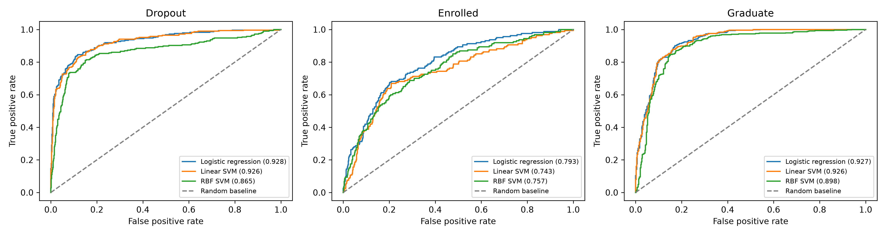

# Tâche 2 — Classification du décrochage et de la réussite universitaire

## 1. Objectif

Cette partie du mini-projet M113 compare trois modèles de classification sur les mêmes données : la régression logistique, le SVM linéaire et le SVM à noyau RBF. Chaque modèle prédit l’une des trois classes de la variable `Target` :

- `Dropout` — abandon des études.
- `Enrolled` — étudiant toujours inscrit.
- `Graduate` — étudiant diplômé.

Le **F1 macro** est le critère principal. Il calcule la moyenne des F1 des trois classes en leur donnant le même poids. Ce choix rend visible la performance sur `Enrolled`, la classe la moins représentée.

## 2. Données et prétraitement

Les données proviennent de la base *Predict Students’ Dropout and Academic Success* de l’UCI. Realinho et ses coauteurs décrivent un jeu de données issu d’un établissement d’enseignement supérieur. Il contient des informations connues à l’inscription ainsi que des résultats des deux premiers semestres. Cette distinction compte pour une application de suivi précoce : la date à laquelle les variables deviennent disponibles détermine à quel moment le modèle peut être utilisé. [Jeu de données UCI][uci] · [Article de présentation][article]

Les trois modèles utilisent les **11 caractéristiques sélectionnées dans la tâche 1** et le même découpage fourni dans `shared/`. Les étiquettes sont alignées sur les observations avec `row_id`, qui sert d’identifiant. Le notebook vérifie l’ordre des caractéristiques, l’unicité des identifiants, les effectifs par classe et la présence de valeurs numériques finies.

| Jeu | Dropout | Enrolled | Graduate | Total |
|---|---:|---:|---:|---:|
| Entraînement | 852 | 476 | 1 325 | 2 653 |
| Validation | 284 | 158 | 441 | 883 |
| Test | 285 | 160 | 443 | 888 |
| **Total** | **1 421** | **794** | **2 209** | **4 424** |

Le `StandardScaler` apprend la moyenne et l’écart-type de chaque caractéristique sur le jeu d’entraînement. Ces mêmes paramètres sont appliqués à la validation et au test. Ce protocole réserve l’estimation du prétraitement au jeu d’entraînement. [Documentation de StandardScaler][scaler]

## 3. Entraînement et choix des configurations

La **régression logistique** apprend une relation linéaire entre les caractéristiques et les scores de classe. Le **SVM linéaire** cherche des frontières linéaires à grande marge. Le **SVM RBF** peut représenter des frontières non linéaires. Le paramètre `C` contrôle le compromis entre régularisation et ajustement aux données. Pour le noyau RBF, `gamma` contrôle la portée de l’influence d’une observation. [Régression logistique][logreg] · [SVM][svc]

Le notebook teste trois valeurs de `C` pour chaque famille : 0,1, 1 et 10. Pour le SVM RBF, il teste d’abord `gamma = "scale"`, `0,01` et `1` avec `C = 1`, puis compare les valeurs de `C` avec `gamma = 1`. Enfin, pour chaque famille, la meilleure configuration non pondérée est comparée à la même configuration avec `class_weight="balanced"`. Cette option accorde davantage de poids aux classes moins fréquentes dans le jeu d’entraînement. [Régression logistique][logreg] · [SVM][svc]

### Résultats sur le jeu de validation

| Modèle | C | Gamma | F1 macro sans pondération | F1 macro avec pondération | Configuration retenue |
|---|---:|---:|---:|---:|---|
| Régression logistique | 10 | — | 0,6593 | **0,6770** | Pondérée |
| SVM linéaire | 10 | — | 0,6657 | **0,6849** | Pondérée |
| SVM RBF | 1 | 1 | **0,6688** | 0,6438 | Sans pondération |

La pondération améliore le F1 macro de la régression logistique et du SVM linéaire d’environ **1,77** et **1,92 points de pourcentage**. Pour le SVM RBF, elle le réduit de **2,51 points**. Le tableau complet dans `classification.ipynb` contient 14 configurations distinctes. Le jeu de test est réservé à l’évaluation des trois configurations retenues sur validation.

## 4. Résultats sur le jeu de test

### 4.1 Indicateurs globaux

Le **F1 pondéré** fait la moyenne des F1 par classe en tenant compte de leurs effectifs. L’**exactitude** mesure la proportion totale de prédictions correctes. [Documentation du F1-score][f1]

| Modèle | F1 macro | F1 pondéré | Exactitude | Prédictions correctes |
|---|---:|---:|---:|---:|
| Régression logistique | **0,707** | **0,762** | 0,747 | 663 / 888 |
| SVM linéaire | 0,696 | 0,751 | 0,733 | 651 / 888 |
| SVM RBF | 0,646 | 0,726 | **0,749** | 665 / 888 |

La régression logistique obtient le meilleur F1 macro sur le test. Le SVM RBF classe correctement deux étudiants de plus. Son F1 macro plus faible reflète des performances moins homogènes entre les classes.

### 4.2 Matrices de confusion et classe Enrolled

Chaque bloc présente une matrice de confusion. Les lignes indiquent les classes réelles et les colonnes les classes prédites. Les valeurs en gras correspondent aux prédictions correctes.

*Figure 1 — Matrices de confusion des trois modèles sur les 888 observations du jeu de test.*

| Modèle | Classe réelle | Prédit Dropout | Prédit Enrolled | Prédit Graduate |
|---|---|---:|---:|---:|
| Régression logistique | Dropout | **198** | 72 | 15 |
| Régression logistique | Enrolled | 22 | **101** | 37 |
| Régression logistique | Graduate | 4 | 75 | **364** |
| SVM linéaire | Dropout | **183** | 88 | 14 |
| SVM linéaire | Enrolled | 19 | **107** | 34 |
| SVM linéaire | Graduate | 3 | 79 | **361** |
| SVM RBF | Dropout | **229** | 22 | 34 |
| SVM RBF | Enrolled | 60 | **39** | 61 |
| SVM RBF | Graduate | 32 | 14 | **397** |

Le SVM linéaire obtient le meilleur rappel pour `Enrolled`, avec **107 étudiants repérés sur 160** (0,669). Sa précision sur cette classe est de 0,391 : environ 39 % des étudiants qu’il prédit comme `Enrolled` appartiennent à cette classe. La régression logistique en repère 101 sur 160 (rappel de 0,631), avec une précision de 0,407. Le SVM RBF en repère 39 sur 160 (rappel de 0,244). Parmi les 121 observations `Enrolled` manquées par le SVM RBF, 60 sont classées `Dropout` et 61 `Graduate`.

### 4.3 Courbes ROC et AUC

Pour chaque courbe ROC, une classe est considérée comme positive et les deux autres sont regroupées. La régression logistique fournit ses probabilités par `predict_proba`. Les SVM fournissent des scores continus par `decision_function`. Pour chaque modèle, l’ordre des colonnes est vérifié avec `classes_`. L’AUC mesure la capacité du score à classer les observations positives devant les autres sur l’ensemble des seuils. [Courbes ROC multiclasse][roc] · [Scores de décision du SVM][svc]

| Modèle | AUC Dropout | AUC Enrolled | AUC Graduate |
|---|---:|---:|---:|
| Régression logistique | **0,928** | **0,793** | **0,927** |
| SVM linéaire | 0,926 | 0,743 | 0,926 |
| SVM RBF | 0,865 | 0,757 | 0,898 |

*Figure 2 — Courbes ROC une-classe-contre-toutes sur le jeu de test. La diagonale en pointillés représente le classement aléatoire.*

`Enrolled` obtient l’AUC la plus faible pour chaque modèle. La régression logistique classe le mieux les observations de cette classe selon l’AUC. Le SVM linéaire détecte le plus d’étudiants `Enrolled` avec ses prédictions finales. Ces résultats correspondent à deux mesures différentes : le classement produit par les scores continus et le rappel obtenu après la décision de classe.

## 5. Discussion et conclusion

- **Régression logistique.** Elle obtient le meilleur F1 macro et les meilleures AUC dans cette expérience. Ses coefficients permettent d’examiner la contribution des variables aux scores de classe. Sa forme linéaire limite sa capacité à représenter des relations non linéaires entre les caractéristiques.
- **SVM linéaire.** Il est intéressant quand la priorité est de repérer davantage d’étudiants `Enrolled`. Sur ce test, le rappel le plus élevé pour cette classe s’accompagne de davantage de fausses alertes que pour la régression logistique.
- **SVM RBF.** Le noyau offre la possibilité d’apprendre des frontières non linéaires, avec un paramètre supplémentaire à régler. La configuration évaluée reconnaît 397 diplômés sur 443 (rappel de 0,896). Elle repère moins d’un quart des étudiants `Enrolled`.
- **Limites du protocole.** La comparaison repose sur un seul découpage et sur 14 configurations. La recherche des paramètres du RBF est séquentielle, donc certaines combinaisons de `C` et `gamma` restent inexplorées. Les résultats décrivent ce jeu de test. Une évaluation sur une autre cohorte serait nécessaire pour mesurer leur généralisation.

**Conclusion.** Si le F1 macro reste le critère principal, la régression logistique pondérée est le modèle à retenir parmi les configurations évaluées. Le rappel de la classe `Enrolled` mérite une attention particulière, car les trois modèles la distinguent moins bien que les autres classes selon l’AUC.

## Références

1. Realinho, V., Vieira Martins, M., Machado, J. et Baptista, L. (2021). [*Predict Students’ Dropout and Academic Success*][uci]. UCI Machine Learning Repository. DOI : 10.24432/C5MC89.
2. Realinho, V., Machado, J., Baptista, L. et Martins, M. V. (2022). [*Predicting Student Dropout and Academic Success*][article]. *Data*, 7(11), 146. DOI : 10.3390/data7110146.
3. Documentation scikit-learn : [StandardScaler][scaler], [LogisticRegression][logreg], [SVC][svc], [F1-score][f1] et [courbes ROC multiclasse][roc].

[uci]: https://doi.org/10.24432/C5MC89
[article]: https://doi.org/10.3390/data7110146
[scaler]: https://scikit-learn.org/stable/modules/generated/sklearn.preprocessing.StandardScaler.html
[logreg]: https://scikit-learn.org/stable/modules/generated/sklearn.linear_model.LogisticRegression.html
[svc]: https://scikit-learn.org/stable/modules/generated/sklearn.svm.SVC.html
[f1]: https://scikit-learn.org/stable/modules/generated/sklearn.metrics.f1_score.html
[roc]: https://scikit-learn.org/stable/auto_examples/model_selection/plot_roc.html
