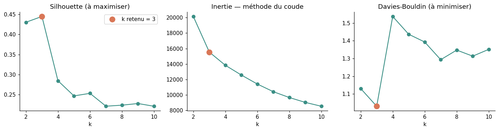
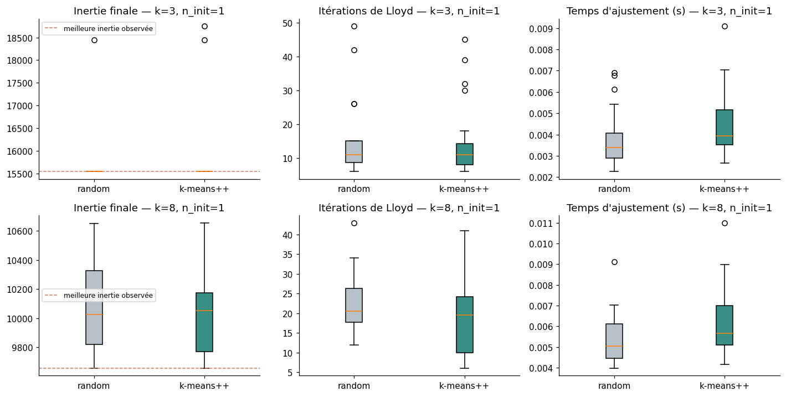
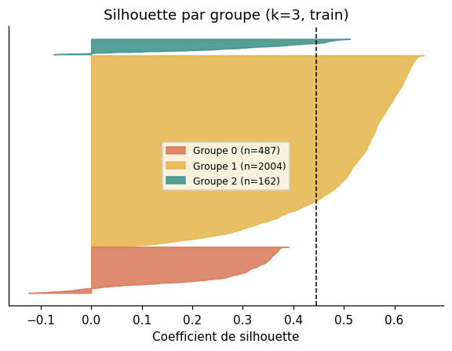
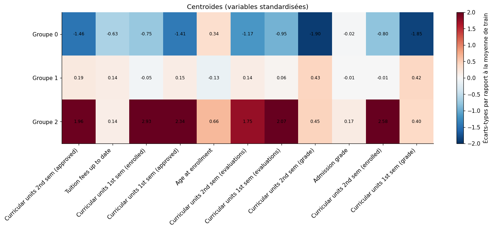
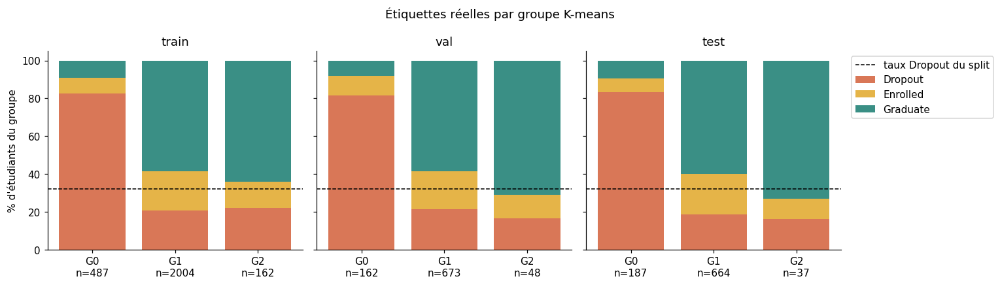
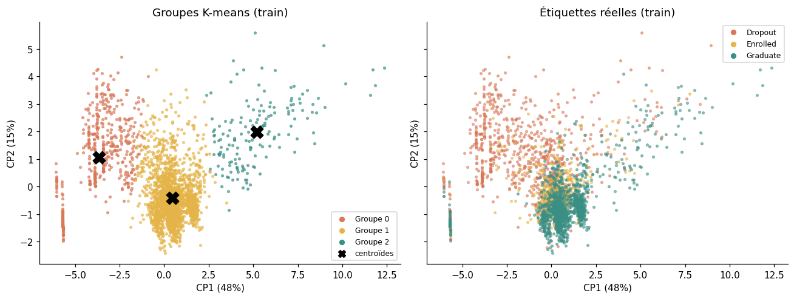

# M113 — Contribution de la tâche 3 : K-means et profils d'étudiants

*Notebook `03_kmeans.ipynb` : version initiale d'Adam, compléments de Charaf. Tous les chiffres proviennent de l'exécution du notebook sur le dossier `shared/` version 1.*

## Objectif

Cette partie cherche si un algorithme non supervisé, K-means, fait apparaître des profils types d'étudiants à partir des 11 caractéristiques retenues par l'arbre de la tâche 1. On vérifie ensuite si certains profils concentrent les décrochages, sans avoir donné les étiquettes à l'algorithme.

## Données et prétraitement

K-means utilise les mêmes splits que les autres tâches : 2653 étudiants de train, 883 de validation et 888 de test. Les caractéristiques sont : `Curricular units 2nd sem (approved)`, `Tuition fees up to date`, `Curricular units 1st sem (enrolled)`, `Curricular units 1st sem (approved)`, `Age at enrollment`, `Curricular units 2nd sem (evaluations)`, `Curricular units 1st sem (evaluations)`, `Curricular units 2nd sem (grade)`, `Admission grade`, `Curricular units 2nd sem (enrolled)`, `Curricular units 1st sem (grade)`. Toutes sont quantitatives, sauf `Tuition fees up to date` (0/1).

K-means repose sur la distance euclidienne. Sans mise à l'échelle, la note d'admission (de l'ordre de 100 à 190) écraserait le nombre d'unités validées (de 0 à une vingtaine). Chaque colonne est donc centrée-réduite avec la moyenne et l'écart-type de **train**, puis les mêmes paramètres sont appliqués à validation et test. `row_id` sert uniquement aux jointures et `Target` n'entre jamais dans l'algorithme.

Les colonnes ont été choisies par un arbre entraîné sur les vraies classes. Le clustering s'effectue donc dans un **espace sélectionné de façon supervisée**, ce qui favorise l'apparition de groupes liés à `Target`.

## Méthode

- **Choix de k.** On teste k de 2 à 10 sur train, avec `init="k-means++"`, `n_init=20` et `random_state=42`. Le critère principal est la silhouette moyenne [4], complétée par l'inertie (coude) et l'indice de Davies-Bouldin [5]. On contrôle que chaque solution forme bien entre 2 et n − 1 groupes. Le choix n'utilise pas les étiquettes.
- **Amélioration étudiée.** On compare l'initialisation standard `random` (k étudiants tirés au hasard) à `k-means++` [3], qui tire les centres successifs proportionnellement au carré de la distance au centre le plus proche. Les deux variantes utilisent le même k, les mêmes graines (42 à 61) et le même `n_init`, d'abord 1 puis 20. On mesure l'inertie, la silhouette, les itérations, le temps et la stabilité (ARI [6] par rapport à la solution de référence). La règle, fixée à l'avance, retient la variante qui atteint le plus souvent la meilleure inertie avec une seule initialisation. Un contrôle complémentaire est fait à k = 8.
- **Code personnalisé.** K-means est réimplémenté avec NumPy (algorithme de Lloyd, deux initialisations, gestion des groupes vides). Il est testé sur des données synthétiques, puis comparé à scikit-learn [7].
- **Interprétation.** Les centroïdes sont ramenés en unités d'origine avec l'inverse du scaler. Des variables d'origine **non utilisées** par K-means (bourse, dette, genre, filière…) servent de variables illustratives. Les groupes sont renumérotés selon les unités validées au second semestre (critère interne). Les vraies étiquettes sont jointes par `row_id` seulement après fixation du modèle. Le modèle est appliqué à validation et test avec `predict`, sans réajustement.
- **Lecture a posteriori.** La fonction `map_labels` du cours [8] associe à chaque groupe sa classe majoritaire sur train. Cela mesure le recouvrement entre groupes et classes, sans servir au choix de k.

## Résultats

### Nombre de groupes

| k | silhouette | inertie | davies_bouldin | effectifs |
| --- | --- | --- | --- | --- |
| 2 | 0.430 | 20149 | 1.131 | 2150/503 |
| 3 | 0.445 | 15538 | 1.031 | 2004/487/162 |
| 4 | 0.285 | 13831 | 1.537 | 1440/630/423/160 |
| 5 | 0.247 | 12568 | 1.437 | 1240/655/408/192/158 |
| 6 | 0.253 | 11402 | 1.393 | 1223/645/336/187/160/102 |
| 7 | 0.221 | 10410 | 1.293 | 950/727/336/206/183/149/102 |
| 8 | 0.224 | 9655 | 1.348 | 896/747/243/211/172/149/133/102 |
| 9 | 0.228 | 9023 | 1.313 | 784/483/428/229/192/172/133/130/102 |
| 10 | 0.221 | 8525 | 1.352 | 831/473/354/227/185/173/130/114/102/64 |

La silhouette maximale est obtenue pour **k = 3** (0.445). k = 2 suit de près (0.430, écart 0.014). Les deux partitions s'emboîtent (ARI = 0.776) : k = 3 conserve le groupe en échec de k = 2 et en détache un petit groupe à forte charge de cours. À partir de k = 4, la silhouette ne dépasse plus 0.285. Aucune solution n'est dégénérée. Une silhouette autour de 0.45 indique une structure réelle mais des groupes qui se touchent.

### Initialisation : random contre k-means++

| k | n_init | variante | inertie_moy | inertie_std | silhouette_moy | iterations_moy | temps_moy_ms | ari_moy | part_meilleure_inertie |
| --- | --- | --- | --- | --- | --- | --- | --- | --- | --- |
| 3 | 1 | k-means++ | 15844 | 945 | 0.4373 | 15.5 | 4.6 | 0.9671 | 90 % |
| 3 | 1 | random | 15683 | 651 | 0.4398 | 15.2 | 3.9 | 0.9819 | 95 % |
| 3 | 20 | k-means++ | 15538 | 0 | 0.4449 | 15.8 | 52.9 | 1.0000 | 100 % |
| 3 | 20 | random | 15538 | 0 | 0.4449 | 15.6 | 45.3 | 1.0000 | 100 % |
| 8 | 1 | k-means++ | 10028 | 319 | 0.2254 | 19.1 | 6.2 | 0.6380 | 0 % |
| 8 | 1 | random | 10060 | 285 | 0.2122 | 22.2 | 5.4 | 0.5235 | 0 % |
| 8 | 20 | k-means++ | 9661 | 24 | 0.2267 | 21.3 | 100.5 | 0.9109 | 5 % |
| 8 | 20 | random | 9700 | 55 | 0.2239 | 29.3 | 87.4 | 0.7422 | 0 % |

À k = 3, avec une seule initialisation, `random` atteint la meilleure inertie connue pour 95 % des graines, contre 90 % pour `k-means++`. Avec `n_init=20`, les deux variantes retrouvent toujours la même partition (ARI minimal = 1). La règle retient donc `random`. Le modèle final est le même avec les deux initialisations : le problème à 3 groupes est assez simple pour que plusieurs départs aléatoires suffisent.

À k = 8, avec `n_init=20`, `k-means++` obtient une inertie moyenne plus faible (9661 contre 9700), moins d'itérations (21.3 contre 29.3) et des partitions plus stables d'une graine à l'autre (ARI moyen 0.91 contre 0.74). L'apport de k-means++ apparaît donc quand le nombre de groupes augmente. La référence de l'ARI est elle-même une solution k-means++, ce qui avantage légèrement cette variante sur ce seul critère ; l'inertie n'a pas ce biais.

### Implémentation NumPy

La version NumPy obtient une inertie de 15537.828, contre 15537.828 pour scikit-learn. La partition est identique (ARI = 1.000). Elle retrouve aussi exactement trois nuages synthétiques bien séparés.

### Stabilité sur validation et test

| split | n | silhouette | groupe_0 | groupe_1 | groupe_2 |
| --- | --- | --- | --- | --- | --- |
| train | 2653 | 0.445 | 487 | 2004 | 162 |
| val | 883 | 0.458 | 162 | 673 | 48 |
| test | 888 | 0.445 | 187 | 664 | 37 |

La silhouette de validation (0.458) et celle de test (0.445) restent proches de celle de train (0.445). Les proportions des groupes sont similaires d'un split à l'autre. La structure n'est donc pas propre aux étudiants de train.

### Centroïdes en unités d'origine (train)

| Variable | Groupe 0 | Groupe 1 | Groupe 2 | Moyenne train |
| --- | --- | --- | --- | --- |
| Effectif (train) | 487 | 2004 | 162 | 2653 |
| Curricular units 2nd sem (approved) | 0.06 | 5.09 | 10.48 | 4.50 |
| Tuition fees up to date | 0.67 | 0.92 | 0.92 | 0.87 |
| Curricular units 1st sem (enrolled) | 4.40 | 6.20 | 13.85 | 6.33 |
| Curricular units 1st sem (approved) | 0.34 | 5.25 | 12.13 | 4.77 |
| Age at enrollment | 25.95 | 22.36 | 28.36 | 23.39 |
| Curricular units 2nd sem (evaluations) | 3.48 | 8.70 | 15.11 | 8.14 |
| Curricular units 1st sem (evaluations) | 4.39 | 8.64 | 17.12 | 8.38 |
| Curricular units 2nd sem (grade) | 0.49 | 12.50 | 12.63 | 10.30 |
| Admission grade | 126.88 | 127.04 | 129.63 | 127.17 |
| Curricular units 2nd sem (enrolled) | 4.48 | 6.26 | 12.08 | 6.29 |
| Curricular units 1st sem (grade) | 1.89 | 12.71 | 12.64 | 10.72 |

Pour `Tuition fees up to date`, la valeur est la proportion d'étudiants à jour de leurs frais.

Variables illustratives, en % du groupe (non utilisées par K-means) :

| Groupe | boursiers_pct | debiteurs_pct | hommes_pct | deplaces_pct | cours_jour_pct |
| --- | --- | --- | --- | --- | --- |
| Groupe 0 | 10.3 | 19.5 | 51.1 | 46.4 | 85.0 |
| Groupe 1 | 28.0 | 10.0 | 30.5 | 58.3 | 90.5 |
| Groupe 2 | 14.8 | 15.4 | 36.4 | 40.1 | 74.1 |
| Ensemble train | 24.0 | 12.1 | 34.6 | 55.0 | 88.5 |

### Répartition des étiquettes réelles

| Split | Groupe | Effectif | % Dropout | % Enrolled | % Graduate | Ratio Dropout |
| --- | --- | --- | --- | --- | --- | --- |
| train | 0 | 487 | 82.8 | 8.0 | 9.2 | 2.58 |
| train | 1 | 2004 | 20.6 | 20.7 | 58.7 | 0.64 |
| train | 2 | 162 | 22.2 | 13.6 | 64.2 | 0.69 |
| val | 0 | 162 | 81.5 | 10.5 | 8.0 | 2.53 |
| val | 1 | 673 | 21.4 | 20.1 | 58.5 | 0.67 |
| val | 2 | 48 | 16.7 | 12.5 | 70.8 | 0.52 |
| test | 0 | 187 | 83.4 | 7.0 | 9.6 | 2.60 |
| test | 1 | 664 | 18.5 | 21.5 | 59.9 | 0.58 |
| test | 2 | 37 | 16.2 | 10.8 | 73.0 | 0.51 |

Le ratio Dropout compare le taux de décrochage du groupe à celui du même split (32.1 % sur train).

| split | purete | reference_classe_majoritaire | ARI | NMI |
| --- | --- | --- | --- | --- |
| train | 0.634 | 0.499 | 0.139 | 0.153 |
| val | 0.634 | 0.499 | 0.135 | 0.152 |
| test | 0.654 | 0.499 | 0.174 | 0.188 |

### Lecture a posteriori avec `map_labels`

| split | accuracy | f1_macro | classes_jamais_predites |
| --- | --- | --- | --- |
| train | 0.634 | 0.445 | Enrolled |
| val | 0.634 | 0.443 | Enrolled |
| test | 0.654 | 0.468 | Enrolled |

Les groupes sont associés à G0 → Dropout, G1 → Graduate, G2 → Graduate. Aucun groupe n'est majoritairement `Enrolled`, cette classe n'est donc jamais prédite. Le F1 macro de test vaut 0.468. À titre de comparaison, le meilleur modèle supervisé de la tâche 2 (Logistic regression) atteint 0.707 sur le même test.

L'ACP, apprise sur train, ne sert qu'à visualiser : ses deux axes conservent 63 % de la variance. K-means a été ajusté sur les 11 dimensions.

## Interprétation des profils

**Groupe 0 — en échec dès le premier semestre (487 étudiants, 18 % de train).** Ces étudiants valident en moyenne 0.34 unité au premier semestre et 0.06 au second, avec des notes moyennes proches de zéro. Ils s'inscrivent aussi à moins d'unités (4.4 contre 6.3 en moyenne). Ils sont plus âgés (25.9 ans contre 23.4) et moins souvent à jour de leurs frais (67 % contre 87 %). Les variables illustratives vont dans le même sens : plus de débiteurs (20 % contre 12 %) et moins de boursiers (10 % contre 24 %). Ce groupe compte **82.8 % de décrocheurs**, 2.6 fois le taux moyen. On retrouve 81.5 % sur validation et 83.4 % sur test. C'est le profil à risque recherché.

Ce groupe contient aussi 101 étudiants de train sans **aucune unité inscrite** aux deux semestres, dont 44 diplômés. Leurs zéros traduisent une absence d'information sur le cursus, pas un échec, et ils forment la bande verticale visible à gauche de l'ACP. Sans ces cas, le groupe 0 compte 93.3 % de décrocheurs sur train (92.7 % sur validation, 95.2 % sur test). Le profil « inscrit à des unités mais n'en valide presque aucune » est donc encore plus nettement associé au décrochage.

**Groupe 1 — parcours régulier (2004 étudiants, 76 % de train).** Environ 6 unités inscrites et 5 validées par semestre, avec des notes autour de 12.5/20. Ces étudiants sont les plus jeunes (22.4 ans) et la plupart sont à jour de leurs frais. La majorité obtient son diplôme (58.7 %), mais le groupe reste mélangé : 20.6 % de décrocheurs et 20.7 % d'inscrits. Il contient 87 % des étudiants `Enrolled` de train. Avec ces variables, la situation « encore inscrit » ne se distingue pas d'un parcours régulier.

**Groupe 2 — forte charge de cours (162 étudiants, 6 % de train).** Ces étudiants s'inscrivent à environ deux fois plus d'unités (13.8 au premier semestre) et en valident beaucoup (12.1), avec des notes comparables au groupe 1. Ils sont plus âgés (28.4 ans) et suivent plus souvent des cours du soir (26 % contre 11 %). Filières les plus fréquentes : Agronomy (17 %); Animation and Multimedia Design (14 %); Management (evening) (14 %). C'est le groupe où la part de diplômés est la plus élevée (64.2 %), mais il est petit et moins homogène que le groupe 1 (silhouette moyenne plus faible).

**Réponse à la question posée.** Oui, un profil à risque se dégage sans utiliser les étiquettes : les étudiants qui ne valident presque rien dès le premier semestre forment un groupe identifiable où plus de quatre étudiants sur cinq décrochent. En revanche, les groupes ne reproduisent pas les trois classes (ARI de test 0.17). `Enrolled` reste noyé dans le parcours régulier, et le groupe 1 contient encore 413 décrocheurs sur 852 en train. K-means décrit des profils mais ne remplace pas un classifieur supervisé.

## Limites

- **Sélection supervisée.** L'arbre a choisi les colonnes avec les étiquettes. L'association groupes/classes est donc en partie favorisée par l'espace de travail.
- **Lecture rétrospective.** Les variables du second semestre sont utilisées, ce qui place l'analyse à la fin de la première année. Un étudiant déjà parti n'a mécaniquement aucune unité validée, si bien que le groupe 0 décrit aussi les conséquences d'un abandon, pas seulement ses signes avant-coureurs.
- **Hypothèses de K-means.** L'algorithme préfère des groupes sphériques de variances proches. Ici, les groupes sont très inégaux (487/2004/162 étudiants) et la silhouette reste modérée. La standardisation donne le même poids à chaque colonne, alors que plusieurs colonnes mesurent des notions proches (unités inscrites, évaluées, validées), ce qui surpondère la réussite académique.
- **Valeurs nulles ambiguës.** Un zéro dans les unités peut signifier un échec ou l'absence d'unités suivies (180 étudiants du groupe 0 sur l'ensemble des splits). K-means traite ces deux situations de la même façon. Un indicateur dédié ou un traitement spécifique dans la tâche 1 permettrait de les distinguer.
- **Un seul découpage**, issu d'une seule institution. Les profils devront être vérifiés sur d'autres cohortes.

## Références

1. Realinho, V., Machado, J., Baptista, L., & Martins, M. V. (2022). Predicting Student Dropout and Academic Success. *Data*, 7(11), 146. https://doi.org/10.3390/data7110146
2. Realinho, V., Vieira Martins, M., Machado, J., & Baptista, L. (2021). Predict Students' Dropout and Academic Success. UCI Machine Learning Repository. https://doi.org/10.24432/C5MC89
3. Arthur, D., & Vassilvitskii, S. (2007). k-means++: The advantages of careful seeding. *Proceedings of the 18th Annual ACM-SIAM Symposium on Discrete Algorithms*, 1027–1035.
4. Rousseeuw, P. J. (1987). Silhouettes: A graphical aid to the interpretation and validation of cluster analysis. *Journal of Computational and Applied Mathematics*, 20, 53–65. https://doi.org/10.1016/0377-0427(87)90125-7
5. Davies, D. L., & Bouldin, D. W. (1979). A cluster separation measure. *IEEE Transactions on Pattern Analysis and Machine Intelligence*, 1(2), 224–227.
6. Hubert, L., & Arabie, P. (1985). Comparing partitions. *Journal of Classification*, 2, 193–218.
7. Pedregosa, F. et al. (2011). Scikit-learn: Machine Learning in Python. *Journal of Machine Learning Research*, 12, 2825–2830. Documentation : [KMeans](https://scikit-learn.org/stable/modules/generated/sklearn.cluster.KMeans.html), [silhouette_score](https://scikit-learn.org/stable/modules/generated/sklearn.metrics.silhouette_score.html).
8. Support de cours M113, *KMeans (Groupement des caractères)*, FST Tanger, 2026.
